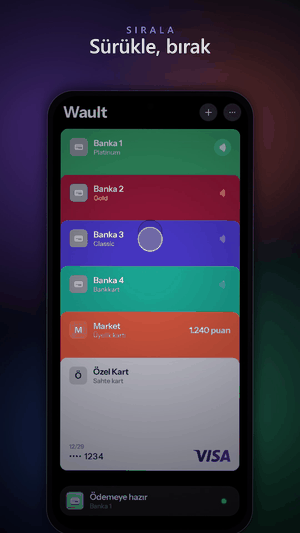

# Wault

[Türkçe](README.tr.md)

A wallet for Android. Payment cards, loyalty cards, QR codes and barcodes, and NFC tags live in one place, stacked like a deck of cards.

<p align="center"></p>

## Features

- **Card stack.** Drag a card up or down to reorder it. Tap to enlarge it. Drag sideways to flip it: the card follows your finger and turns as far as you pull.
- **Payments.** Tap a payment card and the phone's default NFC payment app switches to that bank's app. The bank's app makes the payment; Wault shows the confirmation.
- **Card details.** Store the card number and security code if you want to. They are kept encrypted on the device, shown on the back of the card only after fingerprint or PIN, and each line has a copy button.
- **Loyalty cards and codes.** Scan a barcode or QR code with the camera or from a photo. The format is detected automatically, and the screen brightens when a code is shown.
- **NFC copy.** Read a tag, keep it, and write it to a blank tag later.
- **Personalisation.** Cards are flat colours by default. Pick from 21 presets, the bank app's colour, or any hex colour, and choose a gradient per card if you like. Light, dark and accent colours are in Settings.
- **Fake cards.** A card that only looks like a card. Hold the phone to an NFC tag, enter an amount and a full-screen "Paid" screen plays. It never talks to a payment terminal.
- **Developer mode.** Settings > Developer mode adds a dry-run mode (tapping a card never changes the phone's real payment setting), sample cards and an onboarding preview.

Kotlin, Jetpack Compose. `minSdk 28`, `targetSdk 36`.

## Install

Download `Wault-*.apk` from the [Releases](../../releases) page and install it. The APK is signed with the public Android debug key. That is fine for personal use, but it is not a store signature. To sign it with your own key:

```bash
./gradlew assembleRelease      # app/build/outputs/apk/release/app-release-unsigned.apk
apksigner sign --ks <your-key.jks> --out Wault.apk app-release-unsigned.apk
```

## Build and test

```bash
./gradlew assembleDebug        # app/build/outputs/apk/debug/app-debug.apk
./gradlew testDebugUnitTest    # unit and UI tests, no phone needed
./gradlew lintDebug
```

The UI tests run on the computer with Robolectric. They open the whole app, tap, drag and flip cards, and check pixels to prove that flat cards really are flat. Screenshots are written to `app/build/test-screenshots/`.

If your Windows user name contains non-ASCII characters, Gradle needs `JAVA_TOOL_OPTIONS=-Djdk.net.unixdomain.tmpdir=<project>/.tmp`.

## Developer tools

With Developer mode on (Settings), the Developer group has a dry-run mode, sample cards and an onboarding preview. Debug builds also accept adb extras:

```bash
adb shell am start -n app.wault/.MainActivity --ez dry_run true --ez demo true --ei demo_count 15 --es theme light
```

## Notes

- Design decisions: [DESIGN.md](DESIGN.md) (in Turkish). Asset sources and licence notes: [assets-src/SOURCES.md](assets-src/SOURCES.md).
- Silent payment-app switching needs [Shizuku](https://shizuku.rikka.app). Without it Android's system picker opens instead.
- There are no built-in card face images yet (`CardCatalog` is empty). To add one, put `app/src/main/assets/card_faces/<id>.webp` in place and add a line to the list in `CardImages.kt`. The image must not contain a name or a card number.
- Card network logos (Visa, Mastercard, American Express, Troy) are trademarks of their owners. Check their brand rules before you publish a build.
- The app interface is currently in Turkish.

## License

The code is released under the [MIT License](LICENSE), Copyright (c) 2026 Behlül Barış İşgören. Third-party libraries, the font and the card network logos keep their own terms: see [THIRD_PARTY.md](THIRD_PARTY.md).
