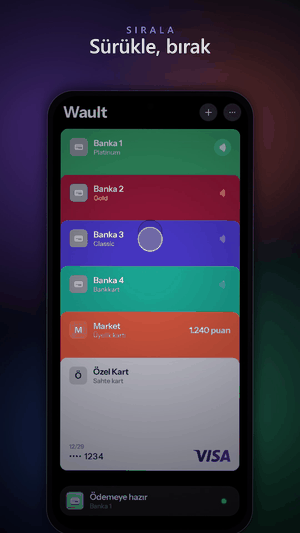

# Wault

[English](README.md)

Android için cüzdan: ödeme kartların, sadakat kartların, QR/barkodların ve NFC kartların tek yerde, üst üste dizili.

<p align="center"></p>

## Özellikler

- **Kart yığını:** kartı yukarı ya da aşağı sürükleyerek sırala, dokunarak büyüt, yana sürükleyerek çevir. Kart parmağı izler, ne kadar çekersen o kadar döner.
- **Ödeme:** ödeme kartına dokununca telefonun varsayılan NFC ödeme uygulaması o bankanın uygulamasına geçer. Ödemeyi bankanın uygulaması yapar, onayı Wault gösterir.
- **Kart bilgileri:** istersen kart numarası ve güvenlik kodunu kaydedersin. Cihazda şifreli durur, kartın arkasında yalnızca parmak izi ya da PIN sonrası görünür, her satırın ucunda kopyalama düğmesi vardır.
- **Sadakat ve kodlar:** barkod ya da QR kodu kamerayla veya fotoğraftan okut. Tür kendiliğinden bulunur, kod görünürken ekran parlaklığı artar.
- **NFC kopya:** bir etiketi oku, sakla, sonra boş bir etikete yaz.
- **Kişiselleştirme:** kartlar varsayılan olarak düz renk. 21 hazır renk, bankanın uygulama rengi ya da istediğin renk kodu; isteyen kart başına gradyan seçer. Tema ve vurgu rengi Ayarlar'da.
- **Sahte kart:** yalnızca kart gibi görünür. Telefonu bir NFC etiketine değdirip tutar yazınca tam ekran "Ödendi" ekranı oynar. Ödeme terminaliyle hiç konuşmaz.
- **Geliştirici modu:** Ayarlar > Geliştirici modu; deneme modu (karta dokunmak telefonun gerçek ödeme ayarını değiştirmez), örnek kartlar, karşılama önizlemesi.

Kotlin, Jetpack Compose. `minSdk 28`, `targetSdk 36`.

## Kurulum

[Releases](../../releases) sayfasındaki `Wault-*.apk` dosyasını indirip kur. APK, herkese açık Android debug anahtarıyla imzalıdır (kişisel kullanım içindir, mağaza imzası değildir). Kendi anahtarınla imzalamak için:

```bash
./gradlew assembleRelease      # app/build/outputs/apk/release/app-release-unsigned.apk
apksigner sign --ks <anahtar.jks> --out Wault.apk app-release-unsigned.apk
```

## Derleme ve test

```bash
./gradlew assembleDebug        # app/build/outputs/apk/debug/app-debug.apk
./gradlew testDebugUnitTest    # birim ve arayüz testleri (telefonsuz)
./gradlew lintDebug
```

Arayüz testleri Robolectric ile bilgisayarda çalışır: uygulamanın bütünü açılır, dokunma, sürükleme ve çevirme denenir, kartların gerçekten düz çizildiği piksellerden doğrulanır. Ekran görüntüleri `app/build/test-screenshots/` altına yazılır.

Windows kullanıcı adında ASCII dışı karakter varsa Gradle için `JAVA_TOOL_OPTIONS=-Djdk.net.unixdomain.tmpdir=<proje>/.tmp` verilmeli.

## Geliştirici araçları

Ayarlar'da Geliştirici modu açıkken deneme modu, örnek kartlar ve karşılama önizlemesi görünür. Debug derlemede adb ile de gönderilebilir:

```bash
adb shell am start -n app.wault/.MainActivity --ez dry_run true --ez demo true --ei demo_count 15 --es theme light
```

## Notlar

- Tasarım kararları: [DESIGN.md](DESIGN.md). Görsel kaynakları ve lisans notları: [assets-src/SOURCES.md](assets-src/SOURCES.md).
- Sessiz ödeme geçişi için [Shizuku](https://shizuku.rikka.app) gerekir; yoksa Android'in sistem seçicisi açılır.
- Hazır kart görselleri şimdilik yok (`CardCatalog` boş). Eklemek için `app/src/main/assets/card_faces/<id>.webp` koyup `CardImages.kt` içindeki listeye satır ekle; üzerinde ad veya numara olmamalı.
- Kart ağı logoları (Visa, Mastercard, American Express, Troy) sahiplerinin markalarıdır; yayınlarken izinleri gözden geçir.
- Uygulama arayüzü şimdilik Türkçe.

## Lisans

Kod [MIT Lisansı](LICENSE) ile yayınlanır, Telif (c) 2026 Behlül Barış İşgören. Üçüncü taraf kütüphaneler, yazı tipi ve kart ağı logoları kendi koşullarında kalır: bkz. [THIRD_PARTY.md](THIRD_PARTY.md).
